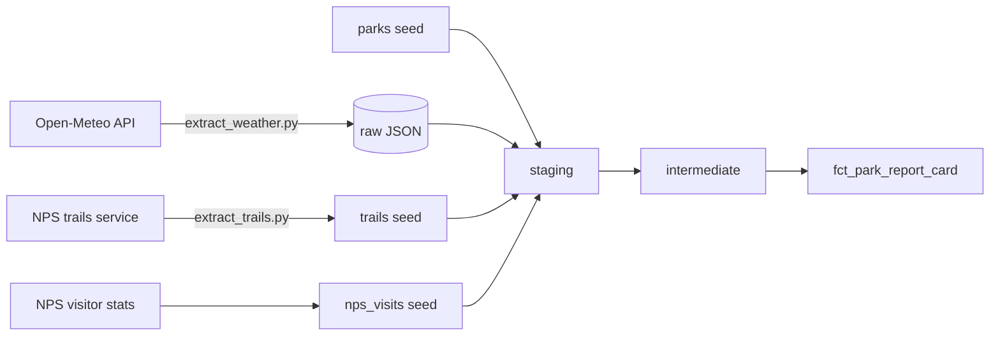

# National Parks Report Card

I wanted to know the best month to visit each national park, so I built a pipeline that grades all 63 parks for every month of the year on weather, crowds and hiking.

Python pulls the raw data from public sources, DuckDB stores it, and dbt does the cleaning, testing and modeling. Nothing needs an API key, so you can clone it and run it yourself.

Built with Python, dbt Core, DuckDB and SQL.

## Pipeline



The dbt project follows the usual staging, intermediate and marts layout.

- **Staging** cleans each source. `stg_weather` unnests the Open-Meteo JSON into one row per park per day, `stg_nps_visits` strips the commas out of the NPS numbers, and `stg_trails` trims the trail names.
- **Intermediate** averages everything by park and calendar month, then turns the averages into scores out of 100 (`int_weather_scores`, `int_crowd_scores`, `int_hiking_scores`).
- **Marts** has one table, `fct_park_report_card`, with one row per park per month and an overall grade.

## Data sources

- **Weather:** daily highs, lows and rain for 2020 to 2025 from the [Open-Meteo historical API](https://open-meteo.com/).
- **Crowds:** monthly recreation visits for 2020 to 2025 from [NPS Visitor Use Statistics](https://irma.nps.gov/Stats/).
- **Trails:** trail names and lengths from the official [NPS Public Trails dataset](https://mapservices.nps.gov/arcgis/rest/services/NationalDatasets/NPS_Public_Trails_Geographic/FeatureServer/0).

Weather gets downloaded when you run the project. The visitor counts and trails barely change, so I committed them as dbt seeds. That way the project doesn't depend on those sources being up when someone runs it.

## Scoring

Weather, crowds and hiking each get a score out of 100. The overall score weights them 40% weather, 40% crowds and 20% hiking. I weighted hiking lowest because it's the roughest of the three and it doesn't change from month to month.

Weather, crowds and hiking each get their own grade on a fixed scale: A is 90 and up, B is 75 to 89, C is 60 to 74, and D is anything below 60. The overall grade is curved instead, because a park's quietest months are usually its worst-weather months, so almost no month scores high on everything. The top 10% of all park-months get an A, the next 30% a B, the next 40% a C, and the bottom 20% a D.

**Weather.** Points for the average high (50 for 60 to 80°F, 30 for 50 to 90°F, 10 otherwise), the average low (20 for 40 to 60°F, 10 for 32 to 70°F, 0 otherwise) and rain (30 for under 0.05 in a day, 15 for under 0.15, 0 otherwise).

**Crowds.** Each month is compared with that park's own busiest month, so a quiet month at a busy park can still score well. Under 40% of peak gets 100, under 60% gets 80, under 80% gets 60, and anything higher gets 40.

**Hiking.** Parks are ranked by total trail miles, and the rank becomes a score from 40 (fewest miles) to 100 (most). I first compared every park with the one that had the most miles, but Yellowstone is so far ahead that almost every other park ended up at the bottom. Ranking spreads them out evenly. Parks with no trails in the NPS data get 40.

## Running it

I've tested this on Windows 11 with Python 3.14 and dbt Core 1.12. The steps below are for Windows PowerShell, with Mac and Linux differences noted. The whole thing takes about 15 minutes, most of it waiting for the weather download.

### 1. Install the tools

You need two things installed first:

- **Python 3.12 or newer**, from [python.org](https://www.python.org/downloads/). On Windows, tick **"Add python.exe to PATH"** on the first screen of the installer.
- **Git**, from [git-scm.com](https://git-scm.com/downloads). The default options are fine.

To check they're installed, open PowerShell (search for "PowerShell" in the Start menu) and run:

```
python --version
git --version
```

Each should print a version number. If you get "not recognized", close PowerShell, open it again, and retry. If it still fails, reinstall and make sure Python is added to PATH.

### 2. Download the project

Pick a folder for it, then clone the repo. This example uses `C:\projects`:

```
mkdir C:\projects
cd C:\projects
git clone https://github.com/patrickjohnson-data/national-parks-report-card.git
cd national-parks-report-card
```

You're now in the project's main folder. Steps 3 to 5 run from here.

### 3. Set up a virtual environment

A virtual environment keeps this project's packages separate from anything else on your computer.

```
python -m venv .venv
.venv\Scripts\Activate.ps1
```

When it's active, your prompt starts with `(.venv)`. If you open a new PowerShell window later, run the second line again from this folder.

If PowerShell says running scripts is disabled, run this once and then try the activate line again:

```
Set-ExecutionPolicy -Scope CurrentUser RemoteSigned
```

On Mac or Linux, activate with `source .venv/bin/activate` instead.

### 4. Install the packages

```
pip install -r requirements.txt
```

This installs dbt, the DuckDB adapter and the requests library. It takes a minute or two.

### 5. Download the weather

```
python extract/extract_weather.py
```

You'll see a line for each of the 63 parks. Open-Meteo's free tier limits how fast you can download, so the script sometimes pauses for 60 seconds and then carries on. That's normal. If it stops partway, run it again and it picks up where it left off.

The weather files are saved in `data/raw/weather`. The visitor counts and trails are already in the repo, so there's nothing else to download.

### 6. Build and test with dbt

dbt has to run from the `national_parks` folder inside the project:

```
cd national_parks
dbt build
```

`dbt build` loads the seed files, builds every model in order and runs all the tests. It finishes in under a minute, and the last line should show `ERROR=0`.

If you see "No dbt_project.yml found", you're in the wrong folder. Run `cd national_parks` and try again.

### 7. Look at the results

To see the 20 best park months:

```
dbt show --inline "select park_name, month_name, overall_score, overall_grade from {{ ref('fct_park_report_card') }} order by overall_score desc" --limit 20
```

To see one park, change the name in this query:

```
dbt show --inline "select month_name, weather_grade, crowd_grade, hiking_grade, overall_grade from {{ ref('fct_park_report_card') }} where park_name = 'Zion' order by month_number" --limit 12
```

All the data lives in `national_parks/dev.duckdb`, which you can open in [DBeaver](https://dbeaver.io/) or another DuckDB client. To browse the models and the lineage graph in your browser, run `dbt docs generate` and then `dbt docs serve`. Press Ctrl+C in PowerShell to stop it.

## Refreshing the data

`python extract/extract_weather.py --refresh` downloads the weather for every park again. Without `--refresh` it skips parks it already has.

For trails, delete the files in `data/raw/trails` and run `python extract/extract_trails.py`. It rebuilds `seeds/trails.csv`.

The visitor counts are a manual step, because NPS Stats doesn't have a download API. Export the "Query Builder for Public Use Statistics" report as CSV (National Parks only, Recreation Visits) and replace `seeds/nps_visits.csv`. NPS finalizes the numbers once a year, so once a year is enough.

## Tests

`dbt build` runs 30 tests. Besides the usual `not_null`, `unique` and `accepted_values` checks, there are a few custom ones: one row per park per day in the weather, one row per park per month in the report card, exactly 12 months for every park, and no park missing from the final table.

## Limitations

- Crowd numbers are for the whole park. I couldn't find free trail-level crowd data, since AllTrails and Strava don't have public APIs.
- 2020 includes COVID closures, so some 2020 months look quieter than they really were.
- Low visitor numbers don't always mean a good time to visit. Some months are quiet because a park is hard to reach, for example when snow keeps roads closed, so a high crowd score can reward an inaccessible month.
- Weather comes from one point per park, using approximate park centers. Big parks with a lot of elevation change can be much warmer or colder in other areas.
- Hiking rewards total miles, so big parks beat small parks with famous hikes, like Zion. The NPS data may also include some informal trails.
- A few parks have no trails in the NPS data, mostly the marine parks and remote Alaska parks. Sequoia and Kings Canyon are managed together, so their trails may be filed under one code.
- The grades describe a typical month based on past years. They aren't a forecast.

## What I'd add next

- A GitHub Actions schedule to refresh the weather
- Incremental weather loads instead of re-downloading every year
- Snow or elevation in the weather score
- A simple web page to browse the report card
